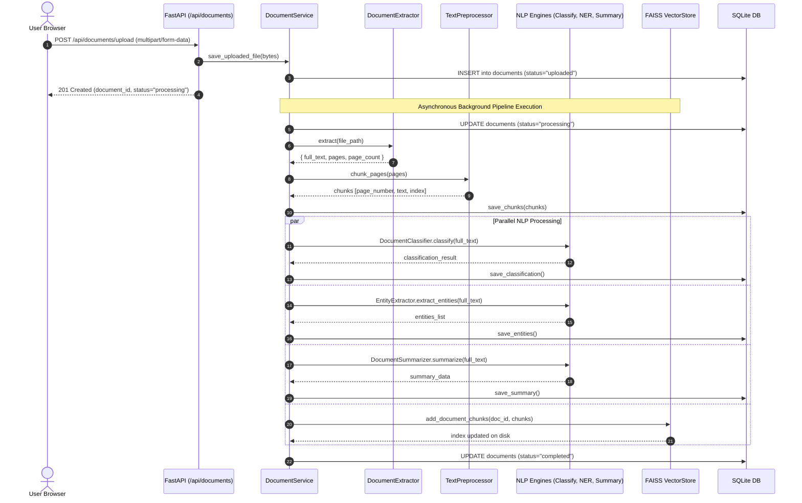
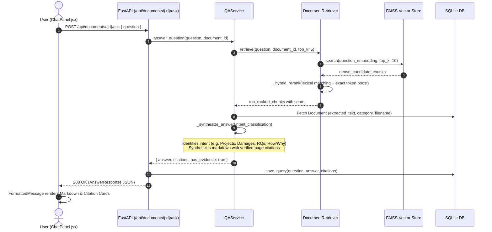
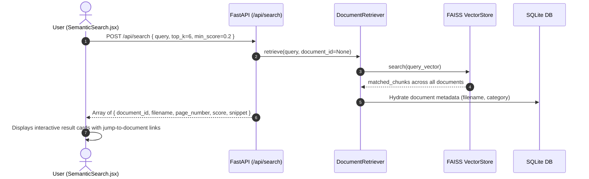
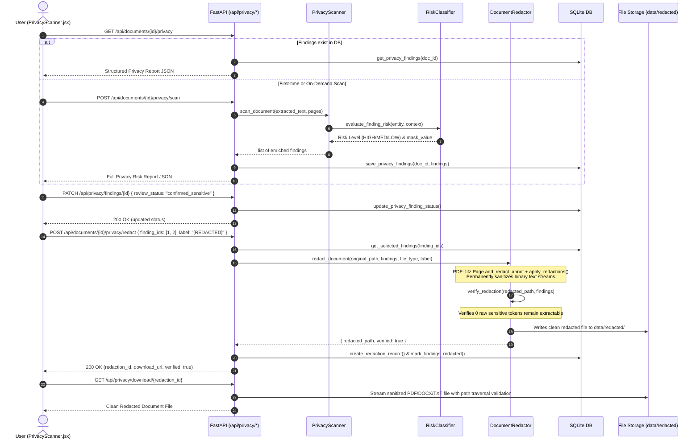
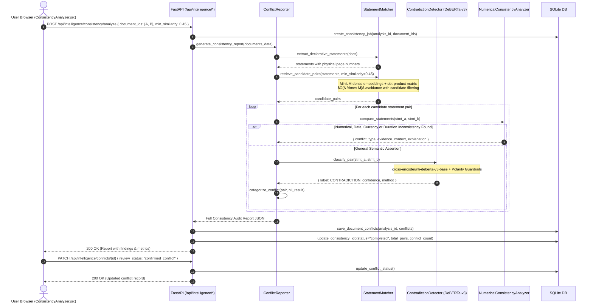

# System Architecture, Module Connectivity & Feature Specifications

**DocuIntellect - Enterprise AI Document Intelligence Platform**  
*Comprehensive Technical Manual, Module Dependencies, Data Pipelines, and System Architecture*

---

## 1. Executive Summary & System Vision

**DocuIntellect** is a production-grade, local-first AI Document Intelligence and Retrieval-Augmented Generation (RAG) platform. The system ingests, normalizes, extracts, classifies, indexes, and analyzes complex multi-page documents (PDF, DOCX, TXT) with zero cloud vendor dependencies.

### Core Architectural Pillars
- **Zero-Cloud Privacy & Local Execution**: Entire NLP inference, embedding generation, semantic vector search, classification, and question answering execute entirely within the local runtime on CPU/GPU without external paid APIs.
- **Deterministic & Grounded RAG**: Eliminates hallucinations by anchoring conversational responses strictly to retrieved passages, enforcing exact page-level citations (`(Page X)`) and snippet evidence verification.
- **Multi-Archetype Document Cognition**: Dynamically identifies document genres (Resumes, Academic Papers, Legal Contracts, Financial Statements, Technical Reports) and alters summarization, entity extraction, and query-answering strategies accordingly.
- **Unified Monorepo Orchestration**: Single-command execution (`npm run dev`) that concurrently boots, manages, monitors, and gracefully terminates both the Python FastAPI backend and the Vite React frontend.

---

## 2. End-to-End System Architecture

The following diagram illustrates the complete architectural topology of DocuIntellect, showing client-side presentation, API routing, business services, local ML/NLP models, and storage layers:

```mermaid
flowchart TB
    subgraph ClientLayer ["Frontend Client Layer (React 19 + Vite)"]
        UI_Dash["Dashboard\n(Metrics & Category Analytics)"]
        UI_Lib["Document Library\n(Upload, Table, Delete)"]
        UI_Detail["Document Detail View\n(Summary, Entities, Q&A, Text)"]
        UI_Chat["Dedicated Chat Interface\n(RAG Grounding & History)"]
        UI_Search["Semantic Vector Search\n(Cross-Document Discovery)"]
        UI_Consist["Consistency Analyzer\n(Cross-Doc Contradiction & Audit)"]
        API_Client["API Service Client\n(src/services/api.js)"]
        
        UI_Dash --> API_Client
        UI_Lib --> API_Client
        UI_Detail --> API_Client
        UI_Chat --> API_Client
        UI_Search --> API_Client
        UI_Consist --> API_Client
    end

    subgraph DevRunner ["Orchestration & Process Lifecycle"]
        NPM_DEV["npm run dev (scripts/dev.js)"]
        NPM_DEV -->|Spawns Client| ClientLayer
        NPM_DEV -->|Spawns API| APILayer
    end

    subgraph APILayer ["FastAPI Backend REST Layer (Port 8000)"]
        MainApp["FastAPI Main (app/main.py)\nCORS, Lifespan, Error Handlers"]
        R_Docs["/api/documents\n(Upload, Detail, Delete)"]
        R_Summ["/api/documents/{id}/summary\n(Fetch, Regenerate)"]
        R_Chat["/api/documents/{id}/ask\n(RAG Q&A, History, Reset)"]
        R_Search["/api/search\n(Cross-Document Vector Search)"]
        R_Priv["/api/documents/{id}/privacy\n/api/privacy/*\n(Scan, Review, Redact, Download)"]
        R_Consist["/api/intelligence/consistency/*\n/api/intelligence/conflicts/*\n(Cross-Doc Contradiction & Consistency)"]
        
        MainApp --> R_Docs
        MainApp --> R_Summ
        MainApp --> R_Chat
        MainApp --> R_Search
        MainApp --> R_Priv
        MainApp --> R_Consist
    end

    API_Client <==>|HTTP / JSON REST API| MainApp

    subgraph PipelineOrchestrator ["Document Pipeline Coordinator"]
        DocService["DocumentService\n(document_service.py)"]
        R_Docs --> DocService
        R_Summ --> DocService
    end

    subgraph ProcessingEngines ["NLP & Machine Learning Processing Services"]
        Extractor["DocumentExtractor\n(PDF, DOCX, TXT, OCR)"]
        Preprocessor["TextPreprocessor\n(Chunking & Normalization)"]
        Classifier["DocumentClassifier\n(Zero-Shot Category Classifier)"]
        NER["EntityExtractor\n(spaCy Named Entity Recognition)"]
        Summarizer["DocumentSummarizer\n(Multi-Archetype Summarizer)"]
        Embedder["EmbeddingModel\n(SentenceTransformers MiniLM-L6)"]
        Retriever["DocumentRetriever\n(Hybrid Dense + Lexical Reranker)"]
        QAService["QAService\n(Intent-Aware RAG Synthesizer)"]
        PrivacyScan["PrivacyScanner\n(Hybrid Regex + spaCy + Luhn)"]
        RiskClass["RiskClassifier\n(Contextual Risk & Masking)"]
        DocRedact["DocumentRedactor\n(PyMuPDF Permanent Redaction)"]
        StmtMatch["StatementMatcher\n(Semantic Candidate Retreival)"]
        ContraDetect["ContradictionDetector\n(cross-encoder/nli-deberta-v3-base)"]
        NumConsist["NumericalConsistencyAnalyzer\n(Currencies, Dates, Durations)"]
        ConflictRep["ConflictReporter\n(Consistency Audit & Synthesis)"]
    end

    DocService --> Extractor
    DocService --> Preprocessor
    DocService --> Classifier
    DocService --> NER
    DocService --> Summarizer
    DocService --> Embedder
    DocService --> PrivacyScan
    PrivacyScan --> RiskClass

    R_Chat --> QAService
    R_Search --> Retriever
    R_Priv --> PrivacyScan
    R_Priv --> DocRedact
    R_Consist --> ConflictRep
    ConflictRep --> StmtMatch
    ConflictRep --> ContraDetect
    ConflictRep --> NumConsist
    StmtMatch --> Embedder
    QAService --> Retriever
    Retriever --> Embedder

    subgraph StorageLayer ["Persistence & Vector Storage"]
        VectorStore["FAISS / NumPy Vector Store\n(IndexFlatIP + metadata.json)"]
        SQLiteDB[("SQLite Database\n(data/app.db via SQLAlchemy)")]
        DiskFiles["Local File Storage\n(data/uploads/)"]
        RedactedFiles["Redacted Documents\n(data/redacted/)"]
    end

    Embedder --> VectorStore
    Retriever --> VectorStore
    DocService --> DiskFiles
    DocService --> SQLiteDB
    DocRedact --> RedactedFiles
    QAService --> SQLiteDB
    R_Docs --> SQLiteDB
    R_Priv --> SQLiteDB
    R_Consist --> SQLiteDB
```



---

## 3. Core Modules Deep-Dive & Technical Specifications

DocuIntellect is architected around 10 decoupled backend modules and 5 core frontend interfaces. Below is the complete specification of each module.

### Module 1: Document Ingestion & Universal Parser
- **File**: `backend/app/services/extractor.py`
- **Class**: `DocumentExtractor`
- **Primary Capabilities**:
  - **PDF Parsing**: PyMuPDF (`fitz`) extracts clean, page-indexed text. Fallback to `pdfplumber` for complex layouts. OCR support via `pytesseract` for scanned image pages.
  - **DOCX Parsing**: `python-docx` for standard XML documents, coupled with a direct OpenXML (`word/document.xml`) fallback that parses ISO/IEC 29500 Strict OOXML schemas when namespace mismatches occur.
  - **TXT Parsing**: Multi-encoding stream reader (`utf-8`, `utf-16`, `latin-1`).
  - **Text Cleaning**: Reconstructs broken hyphenated line breaks (`multi-\nthreaded` $\rightarrow$ `multithreaded`), strips non-printable control characters, and normalizes tabular spaces while maintaining paragraph breaks.
- **Outputs**:
  - `page_count`: Total physical pages.
  - `pages`: Array of `{ page_number: int, text: str, char_count: int }`.
  - `full_text`: Normalized unified text stream.

---

### Module 2: Semantic Chunking & Preprocessing
- **File**: `backend/app/services/preprocessor.py`
- **Class**: `TextPreprocessor`
- **Primary Capabilities**:
  - **Sentence Boundary Preservation**: Uses punctuation look-behinds (`(?<=[.?!])\s+`) to prevent mid-sentence chunk splitting.
  - **Sliding-Window Overlap**: Generates overlapping chunks (default: 500 characters chunk size, 100 characters overlap) to ensure cross-boundary context is never lost during dense vector retrieval.
  - **Page Metadata Encapsulation**: Binds each text chunk directly to its physical source `page_number`, `chunk_index`, and estimated token count.
- **Inputs**: Array of page objects from `DocumentExtractor`.
- **Outputs**: Structured chunk definitions for database persistence and FAISS vector embedding.

---

### Module 3: Vector Embeddings & FAISS Vector Store
- **Files**: `backend/app/services/embeddings.py`, `backend/app/services/vector_store.py`
- **Classes**: `EmbeddingModel`, `VectorStore`
- **Primary Capabilities**:
  - **Embedding Architecture**: Utilizes `sentence-transformers/all-MiniLM-L6-v2` generating 384-dimensional dense semantic vectors.
  - **Vector Normalization**: Automatically normalizes vectors using L2 norm ($|v|_2 = 1.0$), converting Inner Product search into exact Cosine Similarity.
  - **FAISS Indexing**: Employs `faiss.IndexFlatIP` for deterministic nearest-neighbor calculations.
  - **Disk Persistence**: Stores index state to `data/indexes/faiss.index` and serializes chunk mapping metadata to `data/indexes/metadata.json`.
  - **Document Isolation**: Supports scoped queries (`document_id = "..."`) or cross-document universal searches. Supports cascading vector deletions when documents are removed.

---

### Module 4: Hybrid Dense-Lexical Retriever
- **File**: `backend/app/services/retriever.py`
- **Class**: `DocumentRetriever`
- **Primary Capabilities**:
  - **Two-Stage Hybrid Search**:
    1. *Stage 1 (Dense Vector Recall)*: Queries FAISS with the question embedding to retrieve the top $2k$ candidate passages.
    2. *Stage 2 (Lexical & Keyword Re-ranking)*: Calculates sparse keyword overlap, exact alphanumeric token matches (e.g. `RQ1`, `\$500,000`, `99.77%`), and query phrase proximity.
  - **Scoring Formula**:
    $$\text{FinalScore} = 0.70 \times \text{DenseCosineScore} + 0.30 \times \min(\text{LexicalMatchRatio}, 1.0) + \text{ExactPhraseBonus}$$
  - **Relevance Thresholding**: Rejects passages scoring below baseline confidence ($\text{min\_score} = 0.15$), preventing out-of-domain hallucinations.

---

### Module 5: Zero-Shot Document Classifier
- **File**: `backend/app/services/classifier.py`
- **Class**: `DocumentClassifier`
- **Primary Capabilities**:
  - **Domain Taxonomy**: Classifies documents into 6 major archetypes:
    1. `Academic / Research` (papers, literature reviews, methodology, IEEE/ACM formats)
    2. `Legal / Contract` (NDAs, master service agreements, terms, indemnification)
    3. `Financial / Invoice` (balance sheets, expenses, billing statements, tax filings)
    4. `Technical / Engineering` (system architectures, specs, manuals, software designs)
    5. `Human Resources / Resume` (CVs, work history, skill sheets, job applications)
    6. `General Business` (memos, meeting notes, project plans, reports)
  - **Semantic Representation**: Projects document lead paragraphs into the semantic vector space and computes cosine similarity against curated domain keyword clusters.
  - **Outputs**: Top category label, primary confidence score ($0.0 - 1.0$), and full probability distribution.

---

### Module 6: Named Entity Recognition (NER) Engine
- **File**: `backend/app/services/ner.py`
- **Class**: `EntityExtractor`
- **Primary Capabilities**:
  - **spaCy NLP Core**: Powered by `en_core_web_sm` pipeline.
  - **Entity Types Extracted**: `PERSON`, `ORG` (Organizations), `GPE` (Geopolitical Entities/Cities/Countries), `DATE`, `MONEY`, `LAW`, `PERCENT`, `PRODUCT`.
  - **Deduplication & Frequency Aggregation**: Counts occurrences of identical entities across pages while retaining physical page numbers and character offsets.
  - **Entity Tagging**: Used in the UI for rapid entity discovery, compliance auditing, and contract party extraction.

---

### Module 7: Multi-Archetype Hierarchical Summarizer
- **File**: `backend/app/services/summarizer.py`
- **Class**: `DocumentSummarizer`
- **Primary Capabilities**:
  - **Dynamic Noise Filtering**: Strips raw email addresses, URL headers, social profile strings, and pagination artifacts before synthesis.
  - **Archetype-Specialized Synthesis**:
    - *Resume Archetype*: Extracts Profile Summary, Core Competencies, Key Engineering Projects with tech stacks, and Academic Credentials.
    - *Academic Archetype*: Synthesizes Research Context, Hypotheses/RQs, Proposed Methodology, and Empirical Findings.
    - *Legal Archetype*: Outlines Purpose of Agreement, Key Obligations, Remedies/Damages, and Governing Jurisdiction.
    - *Financial Archetype*: Outlines Statement Objective, Major Totals/Amounts, and Key Deadlines.
    - *General Archetype*: Produces Executive Summary, Key Highlights, and Structural Section Analysis.
  - **Output Tiers**:
    1. **Executive Summary Card**: High-level overview.
    2. **Key Takeaways Card**: Bulleted highlights with colored domain category tags.
    3. **Section Breakdown**: In-depth analysis of document subsections.

---

### Module 8: Intent-Aware RAG Question Answering (Q&A) Service
- **File**: `backend/app/services/qa_service.py`
- **Class**: `QAService`
- **Primary Capabilities**:
  - **Intent Classification Engine**: Detects specific question types:
    - `PROJECTS`: Engineering projects, systems built, portfolios, and tools.
    - `RESEARCH_QUESTIONS`: Research questions (`RQ1`, `RQ2`, `RQ3`), study aims, hypotheses.
    - `METRICS_DAMAGES`: Monetary figures (e.g. `\$500,000`), liquidated damages, penalties, CGPA, dates.
    - `SKILLS`: Languages, frameworks, developer tools, soft skills.
    - `EDUCATION`: Degrees, universities, graduation years, academic performance.
    - `LEGAL_TERMS`: Governing laws, jurisdictions, dispute resolution, termination conditions.
    - `HOW_WHY_EXPLANATION`: Architectural workflows, mechanical explanations, and conceptual rationales.
    - `DOCUMENT_OVERVIEW`: Overall purpose, scope, and structural summary.
  - **Multi-Sentence Synthesis**: Synthesizes 2 to 4 interconnected, grammatically complete sentences rather than truncating at the first period or returning isolated headers.
  - **Markdown Formatting**: Formats responses with bold headings, clean bullet points, numbered lists, blockquotes, and inline citations.
  - **Citation Trays**: Each answer returns an array of verified citation objects containing `{ document_id, page_number, score, snippet }`.

---

### Module 9: Relational Persistence Layer
- **Files**: `backend/app/db/models.py`, `backend/app/db/database.py`, `backend/app/db/repository.py`
- **Primary Capabilities**:
  - Built with SQLAlchemy 2.0 over SQLite (`data/app.db`).
  - Strict foreign key constraints with `ondelete="CASCADE"`. Deleting a document instantly and safely purges all associated summaries, entities, classifications, chunks, and chat queries.
  - Repository layer provides transactional encapsulation and atomic database commits.

---

### Module 10: Unified Dev Orchestrator
- **Files**: `scripts/dev.js`, `package.json`
- **Primary Capabilities**:
  - **Single Command Boot**: `npm run dev` starts both FastAPI and Vite.
  - **Cross-Platform Compatibility**: Resolves paths with spaces, sets `PYTHONUNBUFFERED=1`, and handles Windows `.exe` and `.cmd` process semantics.
  - **Process Tree Management**: Executes `taskkill /pid <PID> /T /F` on Windows upon `Ctrl+C` to prevent lingering zombie processes on ports `8000` and `5173`.

---

### Module 11: AI Privacy & Sensitive Information Scanner
- **Files**: `backend/app/services/privacy_scanner.py`, `backend/app/services/risk_classifier.py`, `backend/app/services/document_redactor.py`, `backend/app/api/routes/privacy.py`
- **Classes**: `PrivacyScanner`, `RiskClassifier`, `DocumentRedactor`
- **Primary Capabilities**:
  - **Hybrid Detection Engine**: Combines validated regular expressions, algorithmic checks, contextual keyword windows, and reusable spaCy Named Entity Recognition (`en_core_web_sm`) without reloading NLP models or calling external cloud APIs.
  - **Sensitive Entity Coverage**:
    1. **Indian PAN Cards**: `\b[A-Z]{5}[0-9]{4}[A-Z]\b` with 4th character validation (`P`, `C`, `H`, `F`, `A`, `T`, `B`, `L`, `J`, `G`) and context cues.
    2. **Aadhaar-like Identifiers**: 12-digit grouped/ungrouped sequences (`\b[2-9]\d{3}[\s-]?\d{4}[\s-]?\d{4}\b`) filtered by Verhoeff exclusion, avoiding standard 10-digit phone collisions.
    3. **Bank Account Numbers**: 9-18 digit numerical strings evaluated with proximity context windows (`account`, `a/c`, `savings`, `current`, `deposit`, `beneficiary`).
    4. **IFSC Codes**: RBI-standard 11-character bank codes (`\b[A-Z]{4}0[A-Z0-9]{6}\b`).
    5. **Passport Identifiers**: Indian and international alphanumeric passport patterns (`\b[A-Z][0-9]{7,8}\b`) backed by passport context terms.
    6. **Credit/Debit Cards**: 13-19 digit card patterns with strict **Luhn algorithm checksum verification**.
    7. **Phone Numbers**: Indian 10-digit mobile (+91, 0, with separators) and international ITU E.164 phone numbers with context validation.
    8. **Email Addresses**: RFC 5322 compliant regex with domain suffix validation.
    9. **Person Names**: Reuses cached spaCy NER `PERSON` labels with honorifics (`Mr.`, `Dr.`, `Prof.`) and filter heuristics for common words.
    10. **Residential Addresses**: Multi-part address token analysis (Street, Road, Nagar, Sector, PIN code) and `GPE`/`LOC` entity combinations.
  - **Three-Tier Context-Aware Risk Classification**:
    - `HIGH`: Government IDs (PAN, Aadhaar, Passport), Bank accounts, Credit cards, IFSC codes.
    - `MEDIUM`: Personal phone numbers, Email addresses, Residential addresses.
    - `LOW`: General person names, organizational references, and context-dependent entities.
  - **Explainability & Safe Masking**: Every finding produces an explainable rationale, exact character offsets (`start_char`, `end_char`), physical `page_number`, and a privacy-preserving masked string (`mask_value`, e.g. `ABCDE****F`, `h**********8@gmail.com`, `+91 79****67`). Full raw values are never stored or exposed in logs or summary dashboards.
  - **Interactive Human-in-the-Loop Review**: Users review each detected item in the UI and assign a verification status:
    - `confirmed_sensitive`: Confirmed by user as private data requiring redaction.
    - `not_sensitive`: False positive or public information dismissed by user.
    - `needs_review`: Default initial state awaiting human determination.
  - **Permanent Byte-Level Document Redaction**:
    - **PDF Documents**: Employs PyMuPDF (`fitz.Page.add_redact_annot` followed by `page.apply_redactions()`). Permanently wipes glyphs, font descriptors, and underlying text streams from the binary rather than drawing cosmetic black rectangles.
    - **Post-Redaction Verification Engine**: Extracts all text from the generated PDF and performs an exhaustive substring check against every raw target. If any raw sensitive token remains extractable, the transaction is rejected and an error is raised.
    - **DOCX / TXT Redaction**: Replaces sensitive tokens across paragraphs and table cells, saving a pristine redacted copy in `data/redacted/`.
    - **Original File Preservation**: Uploaded source files in `data/uploads/` are never overwritten or altered.
    - **Path Traversal Protection**: Redacted file downloads are strictly validated using `path.resolve().relative_to(settings.REDACTED_DIR)`.

---

### Module 12: AI Cross-Document Contradiction & Consistency Detector
- **Files**: `backend/app/services/statement_matcher.py`, `backend/app/services/contradiction_detector.py`, `backend/app/services/numerical_consistency.py`, `backend/app/services/conflict_reporter.py`, `backend/app/api/routes/consistency.py`
- **Classes**: `StatementMatcher`, `ContradictionDetector`, `NumericalConsistencyAnalyzer`, `ConflictReporter`
- **Primary Capabilities**:
  - **Statement Extraction & Page Mapping**: Extracts coherent, grammatically complete declarative statements from document text and chunks while binding each statement to its physical source `page_number` and originating `document_id`.
  - **Candidate Pair Retrieval (Avoiding Brute-Force $O(N \times M)$)**:
    - Generates 384-dimensional dense vectors using the existing `sentence-transformers/all-MiniLM-L6-v2` model.
    - Computes batch matrix dot-products $\mathbf{S} = \mathbf{A} \mathbf{B}^T$ and filters statement pairs exceeding the configurable similarity threshold ($\text{min\_similarity} = 0.45$).
    - Boosts candidate priority when statements share recognized entity anchors (e.g. monetary terms, dates, organizations, legal clauses).
  - **Natural Language Inference (NLI)**:
    - Integrates the locally-executable `cross-encoder/nli-deberta-v3-base` transformer model.
    - Employs singleton model caching with `local_files_only=True` to eliminate external cloud dependencies and network latency.
    - Classifies candidate pairs into probability distributions across three formal NLI labels: `CONTRADICTION`, `ENTAILMENT`, and `NEUTRAL`.
    - **Neuro-Symbolic Polarity & Antonym Guardrails**: Augments neural cross-encoder predictions with lexical oppositional rules (e.g. `prohibited` vs `permitted`, `mandatory` vs `optional`, `exclusive` vs `non-exclusive`, `accepted` vs `rejected`), preventing false-positive entailment on polar antonyms.
    - **Explicit Fallback Mode**: When local neural weights are unavailable, automatically activates an explicitly labeled rule-based mode (`semantic_cosine_rule_fallback`), never silently claiming NLI inference.
  - **Specialized Numerical & Date Consistency Analyzer**:
    - **Monetary Normalization**: Parses and normalizes Indian numbering schemes (`₹5,00,000`, `₹5 lakh`, `₹10 crore`) and international currencies (USD, EUR, GBP), converting values into base standard units before contextual comparison.
    - **Calendar Date Normalization**: Converts multi-format calendar strings (`15 December 2026`, `2026-12-15`, `Dec 15, 2026`) into ISO timestamps for comparative diffing.
    - **Project Duration Scaling**: Normalizes durations into standard days (`6 months` $\rightarrow 180 \text{ days}$, `2 years` $\rightarrow 730 \text{ days}$, `4 weeks` $\rightarrow 28 \text{ days}$).
    - **Contextual Compatibility Check**: Only compares numbers sharing semantic context and compatible units; ignores different numbers that refer to separate subjects (e.g. worker nodes vs timeout limits).
    - **Temporal Revision Detection**: Automatically identifies amendment and revision cues (`revised`, `amended`, `updated`, `superseded`) and flags updates as `POTENTIAL_VERSION_CHANGE` with `needs_review` rather than hard factual errors.
  - **8 Formal Conflict Categories**:
    1. `NUMERICAL_INCONSISTENCY`: Divergent project budgets, costs, fees, interest rates, or quantities.
    2. `DATE_INCONSISTENCY`: Conflicting project deadlines, completion dates, or event milestones.
    3. `FACTUAL_CONTRADICTION`: Opposing factual claims, status assertions, or historical events.
    4. `CONTRACTUAL_CONFLICT`: Incompatible contract clauses, terms, warranties, or liability limits.
    5. `RESPONSIBILITY_CONFLICT`: Conflicting deliverables, roles, sub-contracting rights, or duties.
    6. `ENTITY_INCONSISTENCY`: Incompatible names, registration numbers, jurisdictions, or titles.
    7. `POTENTIAL_VERSION_CHANGE`: Compatible chronological updates, amendments, or schedule extensions.
    8. `UNRESOLVED_DIFFERENCE`: High semantic overlap with mismatched measurement units or periods.
  - **Comprehensive Audit Reporting & Side-by-Side Evidence**:
    - Generates multi-document consistency audit reports containing total pairs analyzed, conflict count, severity breakdowns, and category distributions.
    - Side-by-side evidence tracking: Statement A (with Doc Name & Page) vs Statement B (with Doc Name & Page), NLI label, confidence score, and explainable rationale.
  - **Human-in-the-Loop Review Lifecycle**:
    - Supports full review status transitions: `needs_review`, `confirmed_conflict`, `valid_revision`, `false_positive`, `resolved`.

---

## 4. Database Schema & Entity Relationships

The relational database ensures referential integrity across document analysis artifacts:

```mermaid
erDiagram
    DOCUMENTS ||--o| DOCUMENT_SUMMARIES : "has summary"
    DOCUMENTS ||--o{ DOCUMENT_ENTITIES : "contains entities"
    DOCUMENTS ||--o| DOCUMENT_CLASSIFICATIONS : "categorized as"
    DOCUMENTS ||--o{ DOCUMENT_CHUNKS : "split into"
    DOCUMENTS ||--o{ DOCUMENT_QUERIES : "chat history"
    DOCUMENTS ||--o{ DOCUMENT_PRIVACY_FINDINGS : "scanned privacy issues"
    DOCUMENTS ||--o{ DOCUMENT_REDACTIONS : "redaction history"
    DOCUMENTS ||--o{ DOCUMENT_CONFLICTS : "conflicts_as_a"
    DOCUMENTS ||--o{ DOCUMENT_CONFLICTS : "conflicts_as_b"
    CONSISTENCY_ANALYSIS_JOBS ||--o{ DOCUMENT_CONFLICTS : "generated conflicts"

    DOCUMENTS {
        string id PK "UUID (36)"
        string filename "Original filename"
        string file_path "Path in data/uploads/"
        string file_type "pdf, docx, txt"
        int file_size "Bytes"
        int page_count "Total pages"
        string status "uploaded, processing, completed, failed"
        text error_message "Nullable error trace"
        text extracted_text "Full extracted content"
        datetime created_at "Creation timestamp"
        datetime updated_at "Update timestamp"
    }

    DOCUMENT_SUMMARIES {
        int id PK "Autoincrement"
        string document_id FK "Cascade Delete"
        text short_summary "Executive Summary"
        text detailed_summary "Comprehensive breakdown"
        json key_points "Bulleted takeaway array"
        datetime created_at
    }

    DOCUMENT_ENTITIES {
        int id PK "Autoincrement"
        string document_id FK "Cascade Delete"
        string text "Entity text (e.g. Google)"
        string label "PERSON, ORG, DATE, MONEY"
        int start_char "Character start offset"
        int end_char "Character end offset"
        int page_number "Physical page number"
    }

    DOCUMENT_CLASSIFICATIONS {
        int id PK "Autoincrement"
        string document_id FK "Cascade Delete"
        string category "Academic, Legal, Resume..."
        float confidence "Top category confidence"
        json all_scores "Full category distribution"
    }

    DOCUMENT_CHUNKS {
        int id PK "Autoincrement"
        string document_id FK "Cascade Delete"
        int chunk_index "0-indexed order"
        int page_number "Physical page number"
        text text "Chunk body"
        int token_count "Estimated tokens"
    }

    DOCUMENT_QUERIES {
        int id PK "Autoincrement"
        string document_id FK "Cascade Delete (Nullable)"
        text question "User prompt"
        text answer "Synthesized RAG response"
        json citations "Evidence snippet array"
        datetime created_at
    }

    DOCUMENT_PRIVACY_FINDINGS {
        int id PK "Autoincrement"
        string document_id FK "Cascade Delete"
        string entity_type "PAN, AADHAAR, EMAIL, PHONE, etc."
        string masked_value "Safe non-revealing representation"
        string raw_value "Contextual value for redaction mapping"
        string risk_level "HIGH, MEDIUM, LOW"
        string detection_method "regex_pattern_validated, spacy_ner_model"
        float confidence "0.0 to 1.0 confidence score"
        int page_number "1-indexed page position"
        int start_char "Character start offset"
        int end_char "Character end offset"
        text explanation "Auditing rationale"
        string review_status "needs_review, confirmed_sensitive, not_sensitive"
        boolean is_redacted "Redaction flag"
        datetime created_at
    }

    DOCUMENT_REDACTIONS {
        string id PK "UUID (36)"
        string document_id FK "Cascade Delete"
        string original_filename "Original document name"
        string redacted_filename "Sanitized document filename"
        string redacted_file_path "Path inside data/redacted/"
        string file_type "pdf, docx, txt"
        int findings_count "Number of redacted items"
        boolean verified "Byte-level verification result"
        datetime created_at
    }

    CONSISTENCY_ANALYSIS_JOBS {
        string analysis_id PK "UUID (36)"
        json document_ids "Analyzed document UUIDs"
        string status "pending, processing, completed, failed"
        int total_pairs "Candidate pairs evaluated"
        int processed_pairs "Pairs completed"
        int conflict_count "Identified contradictions"
        json categories_summary "Conflict count distribution"
        text error_message "Nullable failure trace"
        datetime created_at "Job initiation timestamp"
        datetime completed_at "Job completion timestamp"
    }

    DOCUMENT_CONFLICTS {
        int id PK "Autoincrement"
        string analysis_id FK "Index"
        string document_a_id FK "Cascade Delete"
        string document_b_id FK "Cascade Delete"
        text statement_a "Extracted declarative assertion A"
        text statement_b "Extracted declarative assertion B"
        int page_a "Source page in Document A"
        int page_b "Source page in Document B"
        string conflict_type "NUMERICAL, DATE, FACTUAL, etc."
        string nli_label "CONTRADICTION, ENTAILMENT, NEUTRAL"
        float confidence "0.0 to 1.0 confidence score"
        text explanation "Neuro-symbolic auditing rationale"
        json evidence_context "Normalized values, units, differences"
        string review_status "needs_review, confirmed_conflict, valid_revision, etc."
        datetime created_at
    }
```



---

## 5. End-to-End Data Pipelines & Lifecycle Flows

### Pipeline 1: Document Upload & Analysis Flow
When a user uploads a document through the web dashboard:



---

### Pipeline 2: Grounded RAG Question Answering Flow
When a user asks a question in the chat panel:



---

### Pipeline 3: Cross-Document Semantic Search Flow
When a user searches keywords or concepts across the entire repository:



---

### Pipeline 4: Privacy Risk Audit & Permanent Document Redaction Flow
When a user audits sensitive data or initiates permanent redaction:



---

### Pipeline 5: Cross-Document Consistency Audit & Contradiction Resolution Flow
When a user selects two or more documents for cross-document consistency auditing:



---

## 6. Frontend Architecture & User Experience Components

The frontend is constructed using React 19, Vite, and Lucide Icons, providing a dark-themed responsive dashboard:

```mermaid
flowchart TD
    App["App.jsx (Navigation & Layout)"]
    Navbar["Navbar.jsx\nBrand, Links, Backend Live Pulse Indicator"]
    
    App --> Navbar
    App --> Dash["Dashboard.jsx"]
    App --> Lib["DocumentLibrary.jsx"]
    App --> Chat["DocumentChat.jsx"]
    App --> Search["SemanticSearch.jsx"]
    App --> Detail["DocumentDetail.jsx"]
    App --> Consist["ConsistencyAnalyzer.jsx"]

    subgraph DetailTabs ["DocumentDetail.jsx (Tabbed Interface)"]
        Tab1["Summary & Insights\n(SummaryPanel.jsx)"]
        Tab2["Extracted Entities\n(EntityPanel.jsx)"]
        Tab3["Grounded Q&A\n(ChatPanel.jsx)"]
        Tab4["Extracted Text\n(Raw Page Viewer)"]
        Tab5["Privacy & Security\n(PrivacyScanner.jsx)"]
    end

    Detail --> DetailTabs

    subgraph ChatComponents ["ChatPanel Subcomponents"]
        FmtMsg["FormattedMessage\n(Custom React Markdown Parser)"]
        Pills["Suggested Prompt Pills\n(Category Dynamic)"]
        CopyBtn["Copy Answer\n(Clipboard + Confirmation)"]
        ResetBtn["Reset Chat\n(DELETE /history)"]
        Citations["SourceCitation.jsx\n(Expandable Citation Cards)"]
    end

    subgraph PrivacyComponents ["Privacy & Security Subcomponents"]
        P_Report["PrivacyReport.jsx\n(Executive Risk Breakdown)"]
        P_Dist["RiskDistribution.jsx\n(Filters, Counts & Search)"]
        P_Card["PrivacyFindingCard.jsx\n(Masked Value, Page, Actions)"]
        P_Redact["RedactionPreview.jsx\n(Modal, Verify & Download)"]
    end

    Tab3 --> FmtMsg
    Tab3 --> Pills
    Tab3 --> CopyBtn
    Tab3 --> ResetBtn
    Tab3 --> Citations
    Chat --> Tab3

    Tab5 --> P_Report
    Tab5 --> P_Dist
    Tab5 --> P_Card
    Tab5 --> P_Redact

    subgraph ConsistencyComponents ["Consistency & Contradiction Subcomponents"]
        C_Select["DocumentComparisonSelector.jsx\n(Document Multi-Picker)"]
        C_Dash["ConsistencyDashboard.jsx\n(KPI Summary & Distribution)"]
        C_Card["ConflictCard.jsx\n(Side-by-Side Conflict Container)"]
        C_Stmt["StatementComparison.jsx\n(Statement A vs B Diffing)"]
        C_Evid["ConflictEvidence.jsx\n(Context & Explanations)"]
        C_Filt["ConsistencyFilters.jsx\n(Category, Status & Search)"]
        C_Rev["ReviewStatus.jsx\n(Interactive Decision Dropdown)"]
    end

    Consist --> C_Select
    Consist --> C_Dash
    Consist --> C_Filt
    Consist --> C_Card
    C_Card --> C_Stmt
    C_Card --> C_Evid
    C_Card --> C_Rev
```



### Key Frontend Features
1. **Dynamic Prompt Suggestions**:
   - `ChatPanel.jsx` inspects the active document's category (`Resume`, `Academic`, `Legal`, `Financial`, `General`) and dynamically populates domain-specific suggested query pills.
2. **Custom Markdown-to-JSX Parser**:
   - Safely renders `**bold**`, `*italics*`, `` `code` ``, `> blockquotes`, bulleted lists (`•`), and numbered lists (`1.`) without requiring unvetted `dangerouslySetInnerHTML` injections.
3. **Expandable Source Evidence Trays**:
   - Displays exact similarity confidence percentages (e.g. `94% match`), page badges (`Page 2`), and preview snippets for complete auditability.
4. **Live System Health Monitoring**:
   - `Navbar.jsx` periodically polls `/api/health` and displays a real-time status beacon (`Backend Connected` vs `Connecting...`).
5. **Interactive Privacy & Security Audit Workspace**:
   - `PrivacyScanner.jsx` provides an executive risk banner, category/risk filter chips, masked sensitive information badges, per-finding user verification toggles (`confirmed_sensitive`, `not_sensitive`, `needs_review`), selective checkboxes for redaction, and a modal preview with verified PDF/DOCX/TXT file download.
6. **Cross-Document Consistency Audit Workspace**:
   - `ConsistencyAnalyzer.jsx` provides multi-document selection, real-time KPI metrics, category-wise distribution breakdown, search & filter bars, side-by-side statement comparisons with physical page references, and an interactive review decision workflow (`confirmed_conflict`, `valid_revision`, `false_positive`, `resolved`).

---

## 7. REST API Contract & Endpoints Matrix

The FastAPI backend exposes a clean REST API documented interactively at `http://127.0.0.1:8000/docs`:

| Method | Endpoint | Description | Request Payload | Response Model |
|---|---|---|---|---|
| `GET` | `/api/health` | System health, database connection, version | None | `{ status, database, version }` |
| `POST` | `/api/documents/upload` | Upload single or batch PDF/DOCX/TXT files | `multipart/form-data` | `DocumentResponse` |
| `GET` | `/api/documents` | List all documents with filtering & pagination | Query: `status`, `skip`, `limit` | `List[DocumentResponse]` |
| `GET` | `/api/documents/{id}` | Retrieve complete document metadata | None | `DocumentResponse` |
| `DELETE` | `/api/documents/{id}` | Cascading delete of document, DB records, vector index & redacted copies | None | `{ status: "success" }` |
| `GET` | `/api/documents/{id}/summary` | Retrieve AI summary, key takeaways, and breakdown | None | `SummaryResponse` |
| `POST` | `/api/documents/{id}/summary/regenerate` | Re-run summarization pipeline | None | `SummaryResponse` |
| `POST` | `/api/documents/{id}/ask` | Grounded RAG Question Answering | `{ question: str, top_k: int }` | `AnswerResponse` |
| `GET` | `/api/documents/{id}/history` | Retrieve chronological Q&A interaction history | None | `List[QueryResponse]` |
| `DELETE` | `/api/documents/{id}/history` | Clear Q&A interaction history for a document | None | `{ status: "success", cleared_count: int }` |
| `POST` | `/api/chat` | Cross-document semantic chat | `{ question: str, top_k: int }` | `AnswerResponse` |
| `POST` | `/api/search` | Natural language semantic vector search | `{ query: str, top_k: int, document_id: str }` | `List[SearchResult]` |
| `GET` | `/api/documents/{id}/privacy` | Fetch executive privacy risk report & findings | None | `PrivacyReportResponse` |
| `POST` | `/api/documents/{id}/privacy/scan` | Run or re-run on-demand privacy analysis | None | `PrivacyReportResponse` |
| `PATCH` | `/api/privacy/findings/{finding_id}` | Update user review status for a finding | `{ review_status: str }` | `PrivacyFindingResponse` |
| `POST` | `/api/documents/{id}/privacy/redact` | Execute byte-level permanent redaction & verification | `{ finding_ids: List[int], label: str }` | `RedactionResultResponse` |
| `GET` | `/api/documents/{id}/privacy/redacted` | Retrieve redaction history for a document | None | `List[RedactionRecordResponse]` |
| `GET` | `/api/privacy/download/{redaction_id}` | Securely stream and download verified redacted file | None | Binary File (`FileResponse`) |
| `POST` | `/api/intelligence/consistency/analyze` | Initiate cross-document contradiction & consistency analysis | `{ document_ids: List[str], min_similarity: float }` | `AnalyzeConsistencyResponse` |
| `GET` | `/api/intelligence/consistency/{analysis_id}` | Retrieve job progress, metrics, and conflict findings | None | `ConsistencyJobResponse` |
| `GET` | `/api/intelligence/conflicts` | Query, search, and filter identified conflicts | Query: `analysis_id`, `conflict_type`, `review_status` | `List[ConflictSummaryResponse]` |
| `GET` | `/api/intelligence/conflicts/{conflict_id}` | Retrieve complete side-by-side evidence context | None | `ConflictDetailResponse` |
| `PATCH` | `/api/intelligence/conflicts/{conflict_id}` | Update user review status for a conflict finding | `{ review_status: str }` | `UpdateConflictStatusResponse` |
| `POST` | `/api/intelligence/consistency/compare` | Direct pairwise document comparison | `{ document_a_id: str, document_b_id: str }` | `DirectCompareResponse` |

---

## 8. Module Connectivity & Dependency Cross-Reference

The matrix below maps the exact inter-module invocation relationships across the codebase:

| Caller / Consumer Module | Callee / Provider Module | Function / Interface Used | Purpose & Data Exchanged |
|---|---|---|---|
| `scripts/dev.js` | `backend/venv/.../python.exe` | `spawn("uvicorn app.main:app")` | Boots backend with `PYTHONPATH` and unbuffered I/O |
| `scripts/dev.js` | `frontend/` (Vite) | `spawn("npx vite")` | Boots frontend dev server on port `5173` |
| `app/main.py` | `app/api/routes/*` | `app.include_router(...)` | Mounts REST endpoints under `/api` prefix |
| `routes/documents.py` | `DocumentService` | `save_uploaded_file()`, `process_document_pipeline()` | Manages file storage and queues background processing |
| `routes/chat.py` | `QAService` | `answer_question()` | Generates intent-aware grounded answers |
| `routes/chat.py` | `app.db.repository` | `save_query()`, `get_document_queries()`, `clear_document_queries()` | Persists and retrieves chat history |
| `routes/search.py` | `DocumentRetriever` | `retrieve()` | Performs hybrid dense + lexical search across FAISS |
| `routes/privacy.py` | `PrivacyScanner` | `scan_document(text, pages)` | Scans document for PII & sensitive patterns |
| `routes/privacy.py` | `DocumentRedactor` | `redact_document(path, findings, type, label)` | Executes permanent byte-level redaction & verification |
| `routes/privacy.py` | `app.db.repository` | `get_privacy_findings()`, `update_privacy_finding_status()`, `create_redaction_record()` | Persists review states, findings, and redaction records |
| `routes/consistency.py` | `ConflictReporter` | `generate_consistency_report()`, `analyze_document_pair()` | Coordinates multi-doc candidate matching, NLI, and numerical diffing |
| `routes/consistency.py` | `app.db.repository` | `create_consistency_job()`, `get_consistency_job()`, `get_document_conflicts()`, `update_conflict_status()` | Persists consistency analysis jobs, findings, and human review decisions |
| `ConflictReporter` | `StatementMatcher` | `extract_declarative_statements()`, `retrieve_candidate_pairs()` | Extracts page-mapped statements & retrieves candidate pairs |
| `ConflictReporter` | `NumericalConsistencyAnalyzer` | `compare_statements()` | Detects monetary, calendar, percentage, and duration differences |
| `ConflictReporter` | `ContradictionDetector` | `classify_pair()` | Executes local NLI inference with neuro-symbolic guardrails |
| `ContradictionDetector` | `CrossEncoder` | `predict([[stmt_a, stmt_b]])` | Evaluates pair with `cross-encoder/nli-deberta-v3-base` |
| `DocumentService` | `DocumentExtractor` | `extract(file_path)` | Parses raw PDF, DOCX, or TXT into text & page array |
| `DocumentService` | `TextPreprocessor` | `chunk_pages(pages)` | Splits pages into overlapping, sentence-aware chunks |
| `DocumentService` | `DocumentClassifier`| `classify(full_text)` | Categorizes document into 1 of 6 domain archetypes |
| `DocumentService` | `EntityExtractor` | `extract_entities(full_text)`| Runs spaCy NER to extract structured entities |
| `DocumentService` | `DocumentSummarizer`| `summarize(full_text)` | Produces executive summary and key takeaways |
| `DocumentService` | `PrivacyScanner` | `scan_document(full_text, pages)` | Automated step 7 privacy scanning on initial upload |
| `DocumentService` | `vector_store` | `add_document_chunks()` | Encodes chunks with MiniLM and updates FAISS index |
| `PrivacyScanner` | `RiskClassifier` | `classify_risk(entity, context)`, `mask_value(entity, val)` | Computes contextual risk tier and non-revealing mask |
| `DocumentRedactor` | `PyMuPDF (fitz)` | `page.add_redact_annot()`, `page.apply_redactions()` | Sanitizes PDF content streams permanently |
| `QAService` | `DocumentRetriever` | `retrieve(question)` | Obtains top candidate passages from FAISS |
| `QAService` | `app.db.database` | `SessionLocal()` | Fetches full document text and classification for intent routing |
| `DocumentRetriever` | `vector_store` | `vector_store.search()` | Queries FAISS `IndexFlatIP` with normalized vectors |
| `vector_store` | `EmbeddingModel` | `get_embeddings()` | Translates raw text strings into 384-d float vectors |
| `DocumentService` | `app.db.repository` | `update_document_status()` | Transitions document states: `uploaded` $\rightarrow$ `processing` $\rightarrow$ `completed` |

---

## 9. Verification & Execution Instructions

### Running the Entire System (One Command)
In the project root directory, run:
```bash
npm run dev
```

### URLs
- **Web Application UI**: [http://127.0.0.1:5173](http://127.0.0.1:5173)
- **FastAPI REST API**: [http://127.0.0.1:8000](http://127.0.0.1:8000)
- **Interactive Swagger Docs**: [http://127.0.0.1:8000/docs](http://127.0.0.1:8000/docs)

### Running Automated Test Suites
To verify all services, extractors, chunkers, classifiers, and summarizers:
```bash
pytest backend/tests/test_services.py -v
```
To verify the AI Privacy & Sensitive Information Scanner:
```bash
pytest backend/tests/test_privacy.py -v
```
To verify the AI Cross-Document Contradiction & Consistency Detector:
```bash
pytest backend/tests/test_consistency.py -v
pytest backend/tests/test_consistency_api.py -v
```
To verify the frontend production build:
```bash
npm --prefix frontend run build
```

